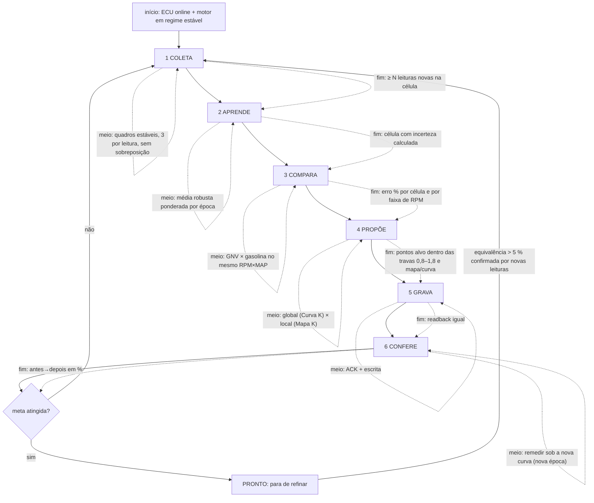

# Aprendizado do app e fluxo do Refino (início, meio, fim) — 2026-10-16

## O que o app aprende (três camadas, cada uma com regra própria)
| Camada | O que é | Depende da Curva K? | Regra |
|---|---|---|---|
| 1. Gasolina | pares RPM×MAP → petrol_ms medidos rodando em gasolina | NÃO | nunca zera; é a referência |
| 2. GNV | os mesmos pares medidos rodando em GNV, sob a Curva/Mapa K de então | SIM (o K muda o combustível entregue) | guarda por **época**; ao gravar K, a época antiga vira "histórico com peso menor", não é apagada |
| 3. O carro | padrões estáveis (ex.: nós 0–3 ms 22 % abaixo dos 8–22 na ECU; razão gás/gasolina por RPM) | NÃO (muda devagar) | persiste entre versões (`.omegas` + sessões) |

**Por que hoje se zera (e por que isso é o problema):** `EquivalenceLedger.resetGas()` apaga a camada 2 inteira a cada gravação — correto em princípio (os pares antigos foram medidos com outro K), mas joga fora tudo e o Refino recomeça do zero, propõe com pouca evidência e oscila (−6 %, +10 %, volta a 1,0 em 3 min; 13 zeragens numa sessão).
**O que muda:** não apagar, **datar**. Decisões usam só a época atual + o histórico descontado; o histórico só vale como "previsão" se a re-escala (K_novo/K_velho) for **validada** contra as sessões (se a validação falhar, o histórico fica só para partida quente e a camada 2 recomeça por época, sem apagar o arquivo).

## Fluxo do Refino (cada etapa com início, meio e fim)

Gatilho extra: AutoMatch da ECU escreveu a curva (`FACTOR_CHANGE_CONFIRMED`) → entra em 3 COMPARA com a curva nova como ponto de partida (Q1: a ECU usa a curva viva).
