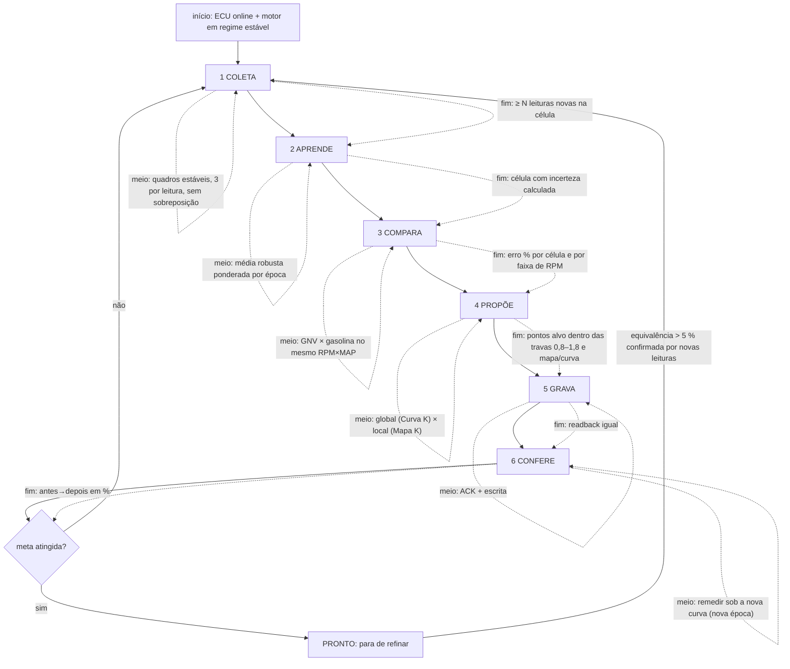
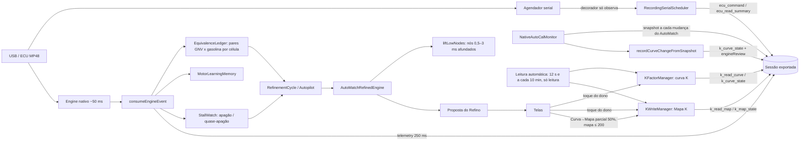

# Refino, aprendizado e AutoMatch — decisões vigentes (um assunto, um arquivo)

> Fundido em 2026-10-20 de seis documentos (aprendizado e fluxo, AutoMatch manual, D1, fechamento 10-18, teia do app, plano 10-16). Texto original preservado; onde uma decisão foi substituída, o trecho diz isso no topo. Regras permanentes em `docs/REGRAS-DO-DONO.md`; pendências em `PENDENTE.md`.
> Aviso vigente: o app NÃO grava sozinho (D1 em LIGADO foi removido em 2026-10-18; "Refino grava sozinho" do plano 10-16 está superado). Sem Claude API no app (D2). Canônica: `OMEGASCANONICO`.

---

## Aprendizado do app e fluxo do Refino (início, meio, fim) — 2026-10-16

### O que o app aprende (três camadas, cada uma com regra própria)
| Camada | O que é | Depende da Curva K? | Regra |
|---|---|---|---|
| 1. Gasolina | pares RPM×MAP → petrol_ms medidos rodando em gasolina | NÃO | nunca zera; é a referência |
| 2. GNV | os mesmos pares medidos rodando em GNV, sob a Curva/Mapa K de então | SIM (o K muda o combustível entregue) | guarda por **época**; ao gravar K, a época antiga vira "histórico com peso menor", não é apagada |
| 3. O carro | padrões estáveis (ex.: nós 0–3 ms 22 % abaixo dos 8–22 na ECU; razão gás/gasolina por RPM) | NÃO (muda devagar) | persiste entre versões (`.omegas` + sessões) |

**Por que hoje se zera (e por que isso é o problema):** `EquivalenceLedger.resetGas()` apaga a camada 2 inteira a cada gravação — correto em princípio (os pares antigos foram medidos com outro K), mas joga fora tudo e o Refino recomeça do zero, propõe com pouca evidência e oscila (−6 %, +10 %, volta a 1,0 em 3 min; 13 zeragens numa sessão).
**O que muda:** não apagar, **datar**. Decisões usam só a época atual + o histórico descontado; o histórico só vale como "previsão" se a re-escala (K_novo/K_velho) for **validada** contra as sessões (se a validação falhar, o histórico fica só para partida quente e a camada 2 recomeça por época, sem apagar o arquivo).

### Fluxo do Refino (cada etapa com início, meio e fim)

Gatilho extra: AutoMatch da ECU escreveu a curva (`FACTOR_CHANGE_CONFIRMED`) → entra em 3 COMPARA com a curva nova como ponto de partida (Q1: a ECU usa a curva viva).

---

## AutoMatch manual — de volta (decisão do dono, 2026-10-17)

**Ideia do dono:** a ECU faz 3 AutoMatches sozinha (cota `MAX_AUTOMATCH`). Depois disso as bandas (os quadradinhos = médias de MAP × Petrol Inj. de cada banda, `*_BUF`/`*_BUF_GAS` + contadores) continuam acumulando. O **AutoMatch manual** manda a ECU aplicar o AutoMatch de novo sobre essas médias já mais maduras; por isso o botão só faz sentido depois da cota automática.

### Evidência no repositório (nada novo no fio)
- Comando: `ActionAutoMatchExecute` → modo `0x08` → `02 24 04 08 32` (`docs/incidents/2026-08-12-…`, `2026-09-19-autocal-final-byte-matrix.md`; `AutoCalProtocolTest`).
- Backend já existia e está testado: `AutoCalNativeActionManager.Action.MANUAL_AUTOMATCH` (prepara → confirma → ACK → leitura de volta de `MUL_ACT`), exposto na ponte (`prepareNativeAction("MANUAL_AUTOMATCH")`, `manualAutoMatchExposed: true`). `NativeAutoCalAcquisitionEpoch` e `RefinementAutopilot` já tratam a readquisição depois dele.
- O que faltava era só o botão na tela (removido em 2026-10-13 por decisão anterior; revogada hoje).

### O que mudou
- Botão **AutoMatch manual (aplica as médias)** no rodapé do AutoCal, nasce escondido; aparece com `autoMatchQuotaReached` (NUM_AUTOMATCH_EXECUTED ≥ MAX_AUTOMATCH) e aprendizado ligado. Um toque, como as outras ações (prepara+executa; proteção = foto da preparação + readback).
- Testes antigos que proibiam o botão foram invertidos (`autocal-cockpit`, `autocal-reacquisition-ux`, `test_v82_integral_regression_contract`) — mudança de regra do dono, não enfraquecimento.
- A sessão registra o resultado: `autocal_native_action` (recibo), `k_curve_state` (curva nova, antes, `engineReview`).

### Ainda aberto (precisa do carro)
- Quando vale apertar: critério por evidência (ex.: nº de bandas maduras e erro do `engineReview` maior que X). Hoje o botão aparece com a cota atingida e o dono decide.
- Efeito físico em motor real (primeiro uso no carro, observando a curva antes/depois na sessão).

### Ponta a ponta (levantamento 2026-10-17, PROTOCOLO-LANDI + Ghidra do ProgBase + nosso código)

**Fio.** Quadro `02 24 04 08 32` (comando AutoCal `0x24`, carga `[04, modo]`, modo 8; checksum `32`). Resposta esperada: ACK `53 00 53`. Mesmo molde dos Reset Gas/Reset All (`…04 02 2C`, `…04 04 2E`), esses sim vistos em captura real.

**Original (ProgBase).** Botão `ButtonAutoMatch` (Tag=8) ao lado de "Num automatch N / [M]". `ActionAutoMatchExecute` → `CommonAction`: confere conexão → caixa de confirmação → ampulheta → envia `[04, Tag]` → sucesso: `Sleep(1000)` + `RefreshAll`; falha: caixa de erro. O `[M]` é editável (`MAX_AUTOMATCH`, `0x0165:2`, ligado a `VECT_AUTOCAL_U8_2`).

**O que a ECU faz num AutoMatch (observado nos AutoMatches nativos, LANDI 17).** Copia buffers do GNV para `*_PREV`; zera buffers/contadores/zonas do GNV; reescreve `MUL_ACT` multiplicando cada nó por uma razão (K novo = K antigo × razão, OBSERVADO; é correção sobre correção). Razões repetidas (1,25/1,12/1,06; 0,88) sugerem um limite de passo, mas é INFERÊNCIA de 7 eventos: AC deu +25/+12/+6 %, LN deu +25/−12/+6 %, K passou de 1,25 (1,40/1,48). Regra DESCONHECIDA; incrementa `NUM_AUTOMATCH_EXECUTED`; buffers da gasolina ficam. Para sozinha ao chegar em `MAX_AUTOMATCH` (3).

**Nosso app (já igual ao original no fluxo).** `AutoCalNativeActionManager.executeFixedAction`: envia → exige ACK → espera 1 s (`HOST_MODE_SETTLE_MS`) → relê `MUL_ACT` (testemunha) → confirma só com a leitura de volta. Botão escondido até `autoMatchQuotaReached`. Sessão grava o recibo e a curva nova.

**Não provado (UNKNOWN).** (1) Nunca houve captura de modo 8 no fio. (2) Efeito real de um 4º AutoMatch (limite de passo, se a ECU recusa acima da cota). (3) Condição que dispara o AutoMatch nativo. (4) Regra de habilitação do botão no original. Primeiro uso no carro deve ser com a sessão ligada para fechar (1) e (2).

**Diferença deliberada.** O original pede caixa de confirmação; o app usa um toque (decisão do dono 2026-10-13: ações em um toque, proteção = foto da preparação + readback).

### Buffers e tela de configurações do original (levantamento 2026-10-17, LANDI 19/22 + DFM)

- **Quem escreve os pontos de aquisição:** a ECU, sozinha. O app só lê (`29 xx 01`). No DFM do original (`TAUTOCALDM`) `PETR_INJ_TBUF`, `MNFLD_PRESS_BUF`, `NUM_BUF_UPD_*`, `*_GAS`, `*_GAS_PREV` e as zonas são **`ReadOnly = True`**; `MUL_ACT`, `GAS_POINT_2DELETE` e `PETROL_POINT_2DELETE` não são. O original nunca escreve nos buffers (nenhum `0x30–0x37` nas 75 985 transações do LANDI).
- **Aprendizado persistente:** existem cópias EEPROM (`TAUTOCALDM_EE`, `0x014E–0x015A`: buffers GNV/gasolina, `BUF_UPD_*_EE`, `MUL_ACT_EE`, **`MUL_PREV_EE`** = curva anterior, `MUL_UPD_CALL_CNTR_EE`). O app não lê essas cópias.
- **`SetVector` vem do original** (`TAebProtocol::SetVector`, VA `0x0092617C`, conferido contra as instruções): `0x30|n` até 5 bytes de dados, `0x37`+tamanho acima. Mas é só paridade de codificação: nenhum chamador de produção no app e nenhum uso do original nos buffers.
- **Tela "Autocal settings" do original (editável):** `MAX_RPM_FOR_AUTOCAL` (400–8000, padrão 3000), `DELTA_ENG_SPD_THD`, `DELTA_MNFLD_PRESS_THD`, `DELTA_PETR_INJ_T_THD`, `DIFF_*` (3), `EN_CDN_T_THD`, "Disable highest acquisition band" (`0x018B`), período de atualização (200–2000 ms) e o vetor `CALIBRATION_VAL_1` de 12 itens (mínimos/soma de amostras por buffer, parado × andando, gasolina × GNV). O app **lê** esses campos e nunca os escreve. Eles controlam o que a ECU aceita como amostra boa (qualidade do aprendizado) — ponto aberto, precisa de decisão do dono e de captura de como o original grava.
- **Sonda de escrita única (APK):** `BufferWriteProbe(Core)`, botão "Testar escrita nos pontos" em Ferramentas (toque duplo). Banda do GNV com contador 10, +8/512 ms em um ponto, quadro `14 5F 01 idx lo hi` (mesmo tipo que grava a curva K), 4 leituras, restaura o original e confere. Desfechos: recusou / aceitou e ficou / aceitou e desfez / aceitou e guardou outro valor / sem banda cheia. Sessão grava `buffer_write_probe` + `ecu_command`. Resultado real: UNKNOWN até rodar no carro.

### Rodada de 2026-10-18 (TDD; cada item com teste e evidência)

| Item | Estado | Evidência / teste |
|---|---|---|
| Estado das bandas antes de cada AutoMatch (`autocal_pre_automatch_state`) | Feito | `PreAutoMatchStateTest.kt`; corpus: gatilho "desconhecido" porque as leituras ficavam 15–217 s longe do evento |
| Leitor de parâmetros só-leitura (`param_snapshot`, 33 parâmetros) | Feito | `EcuParameterSnapshotTest.kt`; cada endereço/largura conferido contra o download de conexão do ProgBase (PortmonLOGNOVO); 6 entradas retiradas por NACK/sem prova |
| Conselho no botão do AutoMatch manual | Feito, regra **provisória** | `tests/ui/manual-automatch-advice.test.cjs`; mediana de 9 bandas com ≥ 3 amostras nos 14 AutoMatches da ECU |
| Sonda de escrita única nos buffers | Feita (Ferramentas, toque duplo) | `BufferWriteProbeCoreTest.kt`; resultado real: **UNKNOWN** até rodar no carro |
| Re-escala dos pares do Ledger por K_novo/K_velho | **NÃO feita** | `docs/evidence/2026-10-18-pares-do-ledger-nao-seguem-o-k.md` (inclinação −0,15; esperado −1) |
| D1 (gravar sozinho após cada AutoMatch) | **NÃO feita** | decisão de 16/10 conflita com "o app nunca aplica sozinho" (17/10); aguarda o dono |
| Equivalência % por nó × RPM; mockups 1/2/3 | Pendentes | dependem de decisão do dono / dos pares do Ledger acima |

Valores reais da ECU (PortmonLOGNOVO, 12/08/2026): `ANTI_STALLO` = 1600·100·1500·2·20 (padrão de fábrica), `GIRI_MIN_CAMBIO` = 1200 rpm, `SMAGRIMENTO_RIENTRO_CUTOFF` = 100, `NUMERO_INIETTATE_SMAGRIMENTO` = 0, aquisição do AutoCal toda no padrão (400/200 rpm, 0,5/0,05 bar, 4/1 ms, 3000 rpm). O original também usa SetVector (`35 03 00 …`) em `FLAG_CONF1` (0x0003): o formato está provado no fio, mas nunca em buffers de aquisição.

---

> **ATUALIZAÇÃO 2026-10-18 (dono): o app NÃO grava sozinho.** O modo LIGADO foi removido (serviço recusa `ON`, valor antigo vira SOMBRA, bloco de escrita apagado). O D1 só calcula e registra `d1_decision`; gravar é sempre manual, e o AutoMatch manual continua manual. O texto abaixo descreve o desenho original.

## D1 — Refino automático depois do AutoMatch (decisão do dono 2026-10-16, reafirmada em 2026-10-18)

**Modos** (interruptor único em Ferramentas): DESLIGADO · **SOMBRA** (padrão: calcula e registra na sessão o que gravaria; nunca escreve) · LIGADO (grava sozinho). Ligar exige toque duplo.

**Fluxo.** A ECU muda a contagem de AutoMatch → o monitor guarda a leitura de ANTES (buffers do GNV ainda cheios; a ECU zera o GNV logo depois) → `engineReview` dessa leitura dá a curva ideal nó a nó → o app lê a curva viva da ECU → `AutoRefinePolicy.decide` → evento `d1_decision` na sessão → só em LIGADO: `KFactorManager.startBatchWrite` (ACK + leitura de volta; motivo "D1 · Refino automático após AutoMatch #n").

**Regras (AutoRefinePolicy, testadas):** sem teto por ponto; travas absolutas 0,8 ≤ K ≤ 1,8 e, com qualquer célula do Mapa K > 200 (ou Mapa desconhecido), K ≤ 1,5; a trava nunca inverte a direção pedida pelo motor; uma vez por AutoMatch; mudança < 0,5 % não vale uma escrita (critério do código, não do dono).

**Não está nesta versão.** (c) correção por faixa de RPM no Mapa K; suavização do serrilhado separada; qualquer validação no carro.

**Limite honesto de evidência.** `docs/evidence/2026-10-18-pares-do-ledger-nao-seguem-o-k.md` mostra que o `petrol_ms` em GNV quase não acompanha o K em ~100 s. A curva ideal vem dos buffers da própria ECU (não dos pares do Ledger), mas se a grandeza não responde ao K, o ciclo "grava → mede → corrige" não fecha sozinho: por isso uma escrita por AutoMatch (no máximo 3–4 por aprendizado) e a SOMBRA como padrão. Antes de ligar, olhar nas sessões os `d1_decision`: quantos pontos, de quanto, se `clamped`, e se `idealFactorsRaw` faz sentido contra `liveFactorsRaw`.

---

## Fechamento 2026-10-18 — regras e tarefas (dono: "termine tudo, por evento, sem gravar sozinho")

### Regras do dono (valem para TODA tarefa)
1. **Tudo por evento/gatilho. Nada por tempo.** Nenhuma decisão do app depende de minutos/segundos (nem "a cada N min", nem "12 s depois"). Gatilhos válidos: sessão USB nova + primeiro quadro válido, mudança de contagem de AutoMatch, mudança de curva/mapa pela ECU, escrita confirmada (ACK+readback), toque do operador, chegada de dado. Os laços de leitura contínua da serial (telemetria) são o fluxo de dados, não decisão: ficam, mas cada um tem que estar listado e justificado em `docs/handoff/EVENTOS-SEM-TEMPO.md`. Proibido criar `setInterval`, `scheduleAtFixedRate`, `scheduleWithFixedDelay`, `Thread.sleep`, `postDelayed`, `delay()` novos como base de decisão. Esperar a ECU = esperar a RESPOSTA (leitura de volta), contando leituras, não relógio.
2. **O app NUNCA grava na ECU sozinho.** Só sugere (grava a sugestão na sessão e mostra na tela). Gravar = ação manual do operador com ACK + leitura de volta. AutoMatch manual continua só por toque.
3. Não mudar bytes/comandos de `UsbSerialManager`, `ResponseDrivenEcuEngine`, `AutoCalProtocol`, `KFactorManager`, `KWriteManager`, `AutoCalNativeActionManager`.
4. TDD: teste que falha primeiro, correção mínima, teste verde. Idempotente: rodar duas vezes dá o mesmo resultado.
5. Texto de tela em português simples. Desconhecido é "—", nunca 0.
6. Verificações locais: `node --test tests/ui/*.test.cjs`, `python3 -B tools/run_checks.py`, `node tools/ci/sem_rolagem_abas.cjs`; Kotlin só compila na CI (escreva os testes JUnit mesmo assim; `kotlinc` local só para arquivos puros).
7. NÃO commitar. Atualizar `PROGRESSO.md` na raiz do seu diretório de trabalho a cada passo.
8. Só mexer nos arquivos do seu escopo. Se precisar de outro arquivo, anote em PROGRESSO.md em vez de editar.

### Evidência de base (já medida)
`docs/evidence/2026-10-18-quadro-gasolina-gnv-k.md` (será criado pela tarefa W5). Gasolina real × equivalente da ECU em GNV concordam em 0–4 % na maior parte das faixas MAP×RPM; MAP < 0,5 chega a 8–12 %.

---

## Teia do app — por onde a informação passa e onde estava o escuro (2026-10-17)

### Falhas achadas ao costurar (e o que foi feito)
| # | Falha | Evidência | Estado |
|---|---|---|---|
| 1 | Mapa K nunca saía na sessão (`MAP_PENDING`); comparações sem o valor do mapa | sessões 18-07 e 18-38 | **corrigido**: leitura automática + `k_read_map` |
| 2 | Mudança de curva pela ECU não tinha os valores nem a origem | `autocal_native_calibration_epoch` só com hash | **corrigido**: `k_curve_state` com origem e `engineReview` |
| 3 | Comandos enviados sem trilha (o que, de quem, ACK) | só `usb_raw` desligado | **corrigido**: `ecu_command` (escritas) e `ecu_read_summary` |
| 4 | Nós 0,5–3 ms sem nenhuma evidência (`TELEMETRY_MIN_MS=3,0`) → o motor só os mantinha afundados | engine + 17/17 AutoMatches −22% | **mitigado**: prior `liftLowNodes` (não provado contra apagão) |
| 5 | Curva→Mapa exportava 100% e empurrava mapa alto | queixa do dono | **corrigido**: 50% + mapa ≤ 200 (`share`, `softMax`) |
| 6 | Apagão é na retomada pós-corte (rpm < 1550: 10%; ≥ 1700: 0,6%), não só valor de K | n=1011 | **aberto**: experimento controlado |
| 7 | Equivalência % por nó × rpm não existe. **Correção do que eu disse antes:** gravar a curva já invalida só o GNV nas faixas de ms afetadas (`invalidateGas`), a gasolina e o resto ficam; o reset TOTAL do GNV acontece na gravação do Mapa K e quando a ECU muda a curva (AutoMatch, `OUTSIDE_AUTOMATCH`) | `EquivalenceLedger.kt`, `RefinementCycle.kt` | **aberto**: usar invalidação por faixa também no AutoMatch (curva antes/depois já é conhecida em `recordCurveChangeFromSnapshot`) e re-escala K_novo/K_velho (validada ~3%) |
| 8 | Buffers da ECU: ~10 amostras/banda, ruído ±15% | snapshot 18-38 | **aberto**: comparar curva suave do app × ECU (precisa normalização dos buffers) |
| 9 | Repositório público contém sessões reais (GPS/identificadores?) | corpus em `tests/fixtures` | **auditado**: no corpus não há GPS, deviceId, nome do aparelho, SSID nem e-mail (busca nos eventos, resumo e colunas da telemetria); só IDs de pastas do Drive, que são privadas |

---

## Plano v2 — inteligência de ponta a ponta (dono, 2026-10-16; refinado com evidência)

Canônica na época: `OmegasVermelho` (hoje `OMEGASCANONICO`). Decisões do dono (16/10): **D1 = sim (SUPERADO em 2026-10-18: o app não grava sozinho)**, o Refino gravava sozinho logo após cada escrita da ECU, sem teto por ponto — só as travas absolutas (0,8 ≤ K ≤ 1,8; mapa > 200 → K ≤ 1,5; mapa nunca abaixo nem acima do que o dono fixou); **D2 = não** à API do Claude dentro do app. Evidência completa: `docs/evidence/2026-10-16-evidencia-arrancada-e-automatch.md`.

### 1. Problema (uma frase)
**Como fazer o app perceber sozinho onde o GNV se afasta da gasolina — sobretudo na saída da lenta — e corrigir rápido, sem apagar o que já aprendeu e sem pedir nada a quem dirige?**
Para quem: o dono, leigo, dirigindo um carro a GNV com ECU Landi-tipo, numa central Android fraca. Sucesso: tempo até +600 rpm no GNV ≤ 1,15 × gasolina no mesmo MAP; zero quase-apagões na saída; equivalência por célula dentro de ±4 % (até 5 %) nas faixas que o carro usa; nenhuma volta a 1,0 "para recomeçar".

### 2. O que os dados dizem (resumo)
A ECU aplica o AutoMatch sobre a curva viva → nossa escrita logo depois é aproveitada (Q1). A lenta no GNV é rica (−14 %) e 2500 rpm em carga é pobre (+5 a +9 %) → correção por RPM = Mapa K (Q2). Na arrancada o GNV recebe 3–9 % mais gás que em regime e demora 50 % mais para ganhar rotação; os quase-apagões são saídas em carga com gás a 20–25 ms (Q3). Gravar + confirmar leva < 1 s na curva e < 3,4 s no mapa; o que trava é a espera de 10 s do pipeline, checkpoints e o Link morto (Q4). E o app zera o aprendizado do GNV a cada gravação, por isso oscila.

### 3. Variações consideradas (e o que ficou)
- **Inversão — a ECU já mediu; leia os buffers dela.** Em vez de só coletar pontos nossos, ingerir `MNFLD_PRESS_BUF`/`PETR_INJ_TBUF` (gasolina e GNV) como pares no Ledger. Fica (fase 2.2): custo quase zero, evidência que a própria ECU usa.
- **Memória com época, não zerada.** Pares medidos sob a curva antiga são re-escalados pela razão K_novo/K_velho da faixa, com peso menor, em vez de apagados. Fica (2.1): resolve a oscilação observada.
- **Refino acompanha o AutoMatch (pedido do dono).** Detectar a escrita da ECU (já existe, ~3 s), suavizar o serrilhado e corrigir pela equivalência, gravar na hora. Fica (2.3), com D1.
- **Um número por célula.** Simplificação: a razão petrol_ms GNV/gasolina por célula RPM×MAP é o estado inteiro do problema; curva corrige o que é comum a todos os RPMs de uma faixa de ms, mapa corrige o resto. Fica como modelo central (2.4).
- **Replay no telefone.** Ao iniciar sem memória, reler as sessões em Documents/OMEGAS e o último `.omegas`. Fica (2.5).
- **Quadros crus em volta de eventos.** Buffer de 20 Hz ±4 s salvo só em arrancada, afundamento, troca de combustível e escrita da ECU. Fica (2.6): barato e dá o replay que falta.
- **Lente de calibrador.** ECUs originais tratam arrancada com enriquecimento transiente por variação de carga; aqui não há esse controle, então a saída tem de ser resolvida no estado estacionário das células de RPM baixo × ms alto (menos gás) e na lenta (rica). Fica como hipótese de correção a provar no carro.
- **API do Claude no laço.** Descartada (D2). O estudo fica aqui; o app roda regras.
- **10×: controle de lambda próprio.** Sem sonda nos dados; descartado.

### 4. Suposições a validar (como)
- [ ] Q1 vale sempre (curva viva): a cada sessão com AutoCal ligado, `analise_janela_automatch.py` recalcula o desvio por hipótese.
- [ ] Menos gás na saída melhora a arrancada: medir tempo até +600 rpm GNV × gasolina no mesmo MAP antes/depois da correção (ferramenta já existe).
- [ ] A lenta rica (−14 %) se mantém com base de gasolina maior e MAP igual: pedir nada ao dono; usar as próximas sessões com paradas em gasolina.
- [ ] Re-escalar pares por K_novo/K_velho reproduz o que a ECU faz: comparar pares re-escalados × pares novos na sessão seguinte à gravação.

### 5. Fatias (ordem; uma branch por fatia; CI verde no SHA; prova 1–3 no CI, 4 no Chromium, 5 só o dono)

#### Fase 1 — segurança, correções e limpeza (em execução, 4 agentes com arquivos disjuntos)
- A (JS): porta de gravação no toque; Curva→Mapa com etapa 2 recuperável ("Concluir curva"); botões do Refino persistentes.
- B (Kotlin autocal): persistência à prova de queda (fsync + .bak + fallback, sem zerar calado); "piorou" só com ≥ 3 % e ≥ 3 células; janela sem sobreposição; Ledger calcula fora da trava.
- C (Kotlin/JS limpeza): apagar painel Wi-Fi e Link; apagar limite de passo e writer morto; espera do pipeline antes de gravar ≤ 1 s.
- D (Kotlin sessão/aprendizado): parar sessão sem travar; poda por teto; salvar aprendizado a cada ≥ 30 s; flush do pipeline ≤ 1 s.
- Depois: registro (AGENTS, hook de regras, STATUS → Vermelho; regra "nenhuma escrita automática" ganha a exceção D1); backups: botão apagar; nenhum arquivo automático em gravação manual; Desfazer pela leitura prévia em memória.

#### Fase 2 — inteligência
- 2.1 Memória com época: cada par guarda a época da curva/mapa; na gravação, re-escalar em vez de zerar (`LEARNING-RESET` some); histerese: proposta nova só com ≥ N células distintas remedidas sob a época nova e sem inverter direção com menos evidência que a anterior.
- 2.2 Buffers da ECU como pares do Ledger (os "quadradinhos"), marcados como origem ECU.
- 2.3 Refino após AutoMatch (D1): ao `FACTOR_CHANGE_CONFIRMED`, calcular (a) suavização do serrilhado (nós fora da tendência dos vizinhos), (b) correção por faixa de ms pela equivalência global, gravar Curva K com readback e registro; (c) correção por faixa de RPM → Mapa K, dentro das travas absolutas; um interruptor único para desligar; sem teto por ponto.
- 2.4 Bins de RPM e ms lidos da ECU (porte de `KMapEcuAxes` da CINZA); tabela de equivalência por célula como estado central; "regime arrancada" = células RPM < 1600 × ms ≥ 6, com a gasolina no mesmo MAP como referência.
- 2.5 Memória que sobrevive a versões: reconstruir do `.omegas` e das sessões ao iniciar vazio (zero toque); curva canônica da gasolina = mediana das aquisições de gasolina do AutoCal no corpus.
- 2.6 Telemetria de transientes (20 Hz ±4 s em eventos) + resumo para IA por sessão (arrancadas, quedas, escritas, equivalência por célula).
- 2.7 Apagar `k_interpolated` (sempre 0) ou calculá-lo de verdade; cursor e telas só repintam o que muda.
- 2.8 Threads que ainda bloqueiam (achados da fatia D, 16/10): `importNativeAutoCalSnapshot` roda no `scheduler` do serviço, a mesma thread de `usbStateChanged` (TelemetryForegroundService ~220/288/828 via NativeAutoCalMonitor ~968) — era ali a espera de 10 s; `saveInternalCheckpoint`/`exportLearning` (flush 2 s) rodam na thread `omegas-k-writer` (KWriteManager ~50/524 → LearningArchiveManager ~136) e no `scheduler`. Mover para executor próprio; nunca na thread do USB nem na principal.

##### Ponteiros de implementação da Fase 2 (lidos no código em 16/10)
- Gatilho da escrita da ECU já existe: `TelemetryForegroundService` → `NativeAutoCalMonitor(onNativeCalibrationObserved = …)` recebe o payload `FACTOR_CHANGE_CONFIRMED` (~3 s após a escrita; `beforeRaw`/`afterRaw` dos 30 nós) e hoje chama `refinement.nativeCurveChanged()` → `EquivalenceLedger.resetGas(OUTSIDE_AUTOMATCH)` + `journal.interrupt(...)`. **É aqui que o app zera o GNV.** Fase 2.1 troca esse reset por re-escala com época; Fase 2.3 chama, no mesmo ponto, a proposta e a gravação automática.
- Motor da proposta: `RefinementCycle.proposal(snapshot, index)` (alinha MUL_ACT, `AutoMatchSnapshotAnalysis.analyzeRefined`, memo por conteúdo) → `RefinementJournal.proposalFrom(analysis, indexNow, indexSince)` devolve `points[{index, currentRaw, targetRaw}]`. A suavização do serrilhado entra como etapa dentro de `analyze` (nós fora da tendência dos vizinhos, por zona), antes da margem.
- Escritor: `KFactorManager.startBatchWrite(points, reason)` (readback final e `BATCH_CONFIRMED`; `elapsedMs` real < 1 s). O interruptor D1 vive no `RefinementAutopilot` (já tem `setManual`/`manual`); a escrita automática registra `automatic=true` no `k_factor_batch_confirmed`.
- Travas absolutas no escritor (não na tela): 0,8 ≤ K ≤ 1,8 (`KFactorProtocol.MAX_WRITE_FACTOR` existe; falta o piso 0,8) e acoplamento com o Mapa K (célula > 200 → K ≤ 1,5) — uma função pura `withinOwnerLocks(curve, map)` testada.
- Buffers da ECU (2.2): campos `MNFLD_PRESS_BUF`, `PETR_INJ_TBUF`, `*_GAS`, `*_GAS_PREV`, `NUM_BUF_UPD_PETR/GAS` já decodificados pelo `AutoCalProtocol`; a tela `autocal-original.js` os desenha ("Painel Acquisition"). Entram no Ledger como pares com origem `ECU`.
- Bins da ECU (2.4): porte de `KMapEcuAxes.kt` (161 linhas) + teste (126) da CINZA (commit `188a7b6`), fiação em `KWriteManager.readEcuAxes` (`29 3D 00` RPM, `29 37 00` tempo; só leitura; falha → eixo fixo + registro).
- Transientes (2.6): `SessionRecorder` grava `telemetry` por amostra (10 quadros crus → 1); o buffer de 20 Hz entra como evento `telemetry_burst` em volta de `engine_stall`, arrancada e `autocal_native_calibration_epoch`.

#### Fase 3 — telas (mockup PNG antes, 1 por tela)
AutoCal sem a Curva K e com o gráfico esticado (quadradinhos = buffers da ECU, explicados em uma frase); Ajuste global com cursor ao vivo e gravação ao tocar +/− ou arrastar (junção de toques 0,6 s; Gravar fica); Sessões roláveis e didáticas, "tamanho e retenção" funcionando; log enxuto.

#### Fase 4 — um APK, SHA-256, carro (classe 5, só o dono).

### 6. Não fazer (e por quê)
- Teto por ponto / por AutoMatch — o dono recusou: atrasa a correção; as travas absolutas bastam.
- API do Claude no app — custo de API fora do Max, internet no carro, laço de controle não determinístico.
- Apagamento automático de pontos (AutoIdle) — o dono quer aprendizado melhor, não apagar.
- Backup automático em gravação manual — o dono não quer arquivo; Desfazer continua pela leitura prévia.
- Tela nova sem mockup aprovado; mudança de bytes da ECU; APK antes do fim.

### 7. Perguntas em aberto
- A lenta rica é efeito da curva (nós 0–3, 0,5–2 ms) ou do Mapa K na primeira linha? (Decide onde entra a correção da lenta; a tabela por célula responde quando houver mais gasolina parada.)
- Quantos AutoMatches por aquisição a ECU faz com AutoCal religado após refino nosso (3 ou 4)? Conta nas próximas sessões.
