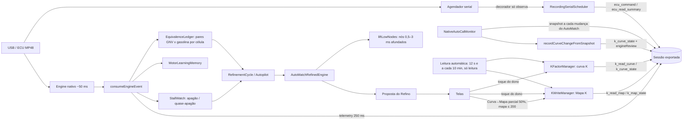

# Teia do app — por onde a informação passa e onde estava o escuro (2026-10-17)

## Falhas achadas ao costurar (e o que foi feito)
| # | Falha | Evidência | Estado |
|---|---|---|---|
| 1 | Mapa K nunca saía na sessão (`MAP_PENDING`); comparações sem o valor do mapa | sessões 18-07 e 18-38 | **corrigido**: leitura automática + `k_read_map` |
| 2 | Mudança de curva pela ECU não tinha os valores nem a origem | `autocal_native_calibration_epoch` só com hash | **corrigido**: `k_curve_state` com origem e `engineReview` |
| 3 | Comandos enviados sem trilha (o que, de quem, ACK) | só `usb_raw` desligado | **corrigido**: `ecu_command` (escritas) e `ecu_read_summary` |
| 4 | Nós 0,5–3 ms sem nenhuma evidência (`TELEMETRY_MIN_MS=3,0`) → o motor só os mantinha afundados | engine + 17/17 AutoMatches −22% | **mitigado**: prior `liftLowNodes` (não provado contra apagão) |
| 5 | Curva→Mapa exportava 100% e empurrava mapa alto | queixa do dono | **corrigido**: 50% + mapa ≤ 200 (`share`, `softMax`) |
| 6 | Apagão é na retomada pós-corte (rpm < 1550: 10%; ≥ 1700: 0,6%), não só valor de K | n=1011 | **aberto**: experimento controlado |
| 7 | Equivalência % por nó × rpm não existe; Ledger apaga o GNV a cada gravação | AGENTS/Ledger | **aberto**: re-escala K_novo/K_velho (validada ~3% em 2 gravações) |
| 8 | Buffers da ECU: ~10 amostras/banda, ruído ±15% | snapshot 18-38 | **aberto**: comparar curva suave do app × ECU (precisa normalização dos buffers) |
| 9 | Repositório público contém sessões reais (GPS/identificadores?) | corpus em `tests/fixtures` | **aberto**: auditar antes de qualquer outra publicação |
