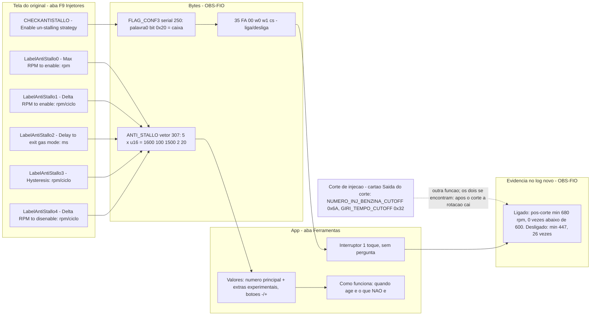

# Anti-apagão (anti-stallo): mapa de conexões

Um só lugar liga: **tela do original → bytes → app → teste → evidência do log**. Marcas: OBS-FIO (visto no fio), OBS-COD (provado no código do ProgBase), INFERIDO.

## Resposta curta (para o dono)
- **Age sempre no corte?** Não. É função própria. Só entra quando a rotação está **abaixo** da "Rotação máxima para agir" **e** cai **mais rápido** que "Queda para agir" (rpm por ciclo). Embreagem pisada, parada, ré, quebra-molas, redução, ou o afundo depois de um corte: todos produzem essa queda rápida; o anti-apagão olha só a queda, não a causa (INFERIDO do rótulo e do log).
- **O corte de injeção é afetado?** Os ajustes do corte (Saída do corte) continuam separados e não são alterados por estes números. No log, o anti-apagão segurou a rotação *depois* dos cortes (OBS-FIO).
- **Unidades:** campos 1, 3 e 4 são **rpm por ciclo** no original (UNITARPMCICLOMOTORE), não rpm simples (OBS-COD, i18n 970).
- **Ainda INFERIDO:** efeito exato de "Espera para sair do gás" (campo 2) e dos extras; o original só mostra o campo 0 (captura F9).

Testes: `tests/ui/anti-apagao-valores-didatico.test.cjs`, `tests/ui/anti-apagao-toque-real.test.cjs`. Código: `app/src/main/assets/ui/core/anti-apagao-valores.js`, `components/advanced.js`.
